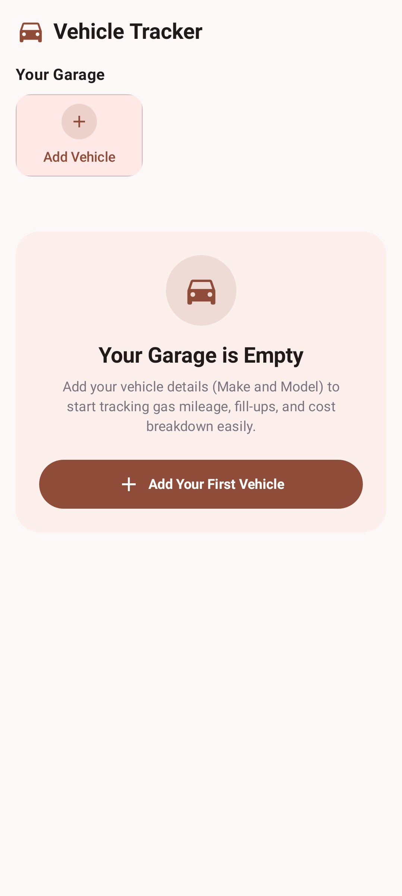
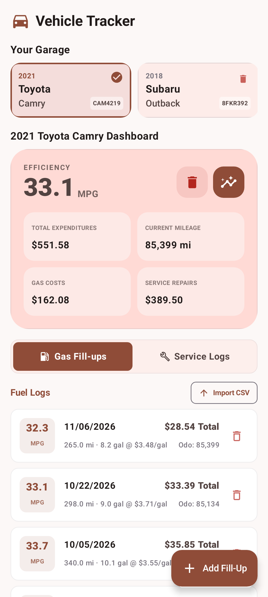
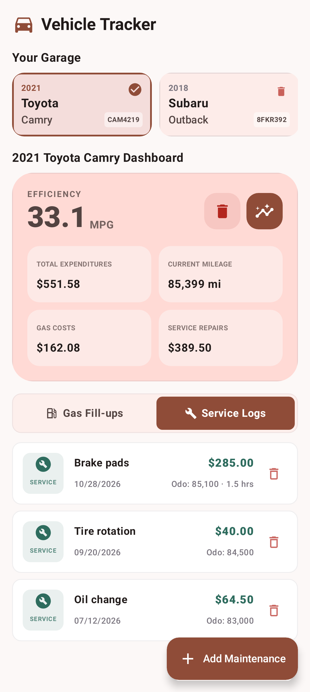
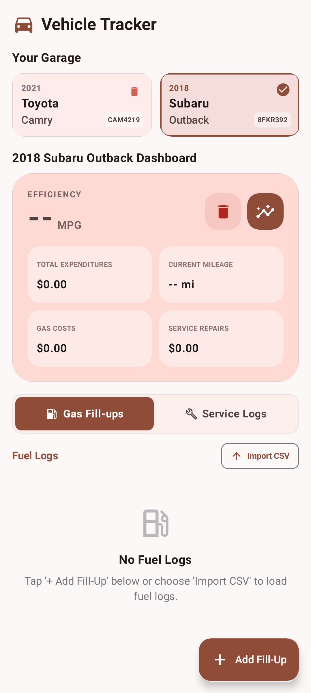
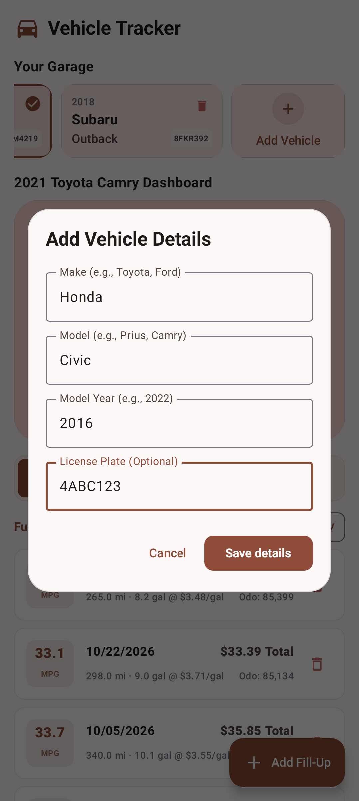
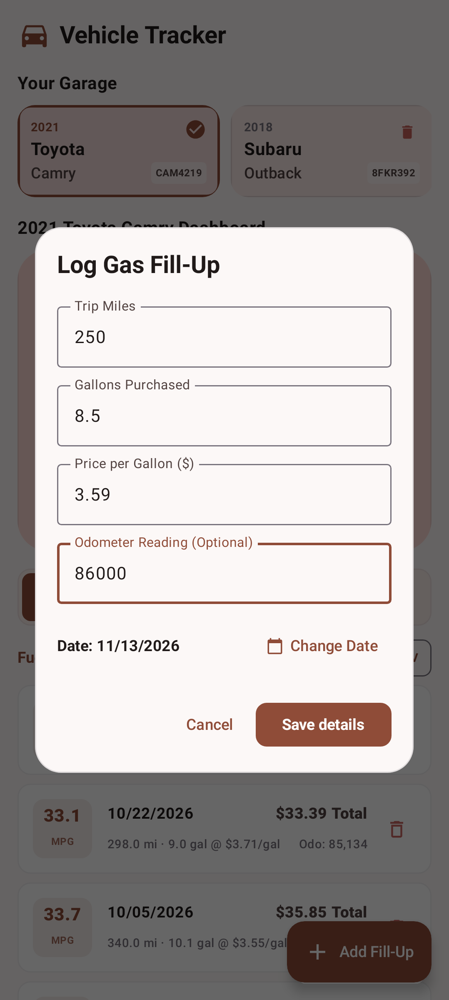
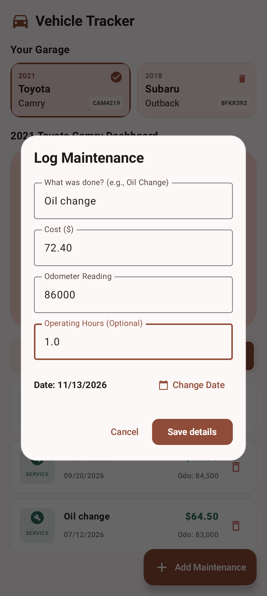
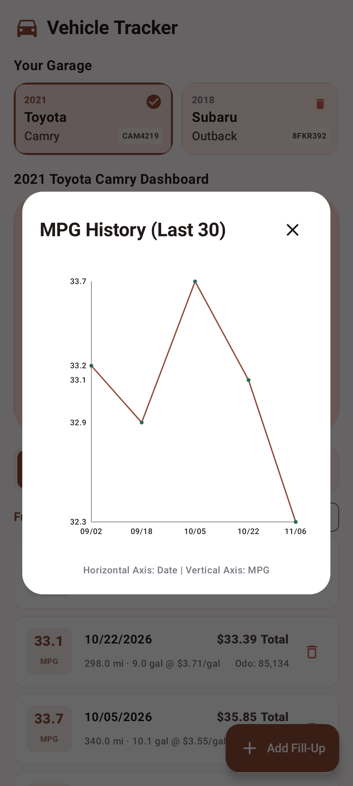

# IOTA Vehicle Tracker

A fully local Android app for tracking vehicles, gas fill-ups, fuel efficiency, expenses, and maintenance. Logs are stored on the device with Room. The UI is Jetpack Compose.

## Prerequisites

- [Android Studio](https://developer.android.com/studio) Panda 4 (2025.3.4) or newer, which supports Android Gradle Plugin 9.2.
- JDK 17 or newer. Android Gradle Plugin 9.2.1 requires JDK 17 to run the build. This project sets the Gradle daemon JVM to JDK 21 in `gradle/gradle-daemon-jvm.properties`. Use JDK 21 for `./gradlew` (`JAVA_HOME`). Android Studio can use its bundled JDK when that JDK is 17 or newer.
- Android SDK Platform 36.1. The app compiles against API 36.1, targets API 36, and supports devices back to API 24.

App bytecode compatibility is Java 11.

## Build and run

### Android Studio

1. Open this directory.
2. Let Gradle sync, and install any SDK components Android Studio asks for.
3. Run the `app` configuration on an emulator or a device.

### Command line

```bash
./gradlew assembleDebug
./gradlew testDebugUnitTest
```

`assembleDebug` produces `app/build/outputs/apk/debug/app-debug.apk`. The debug build type uses `signingConfigs.getByName("debug")`, the standard Android debug keystore (`~/.android/debug.keystore`). The Android Gradle Plugin creates that keystore if it is not already there.

`testDebugUnitTest` runs the local unit tests on the host, including Robolectric tests and Roborazzi screenshot comparisons. No emulator is required. `./gradlew test` runs the same unit-test work when that aggregate task is available.

## Release signing

Release builds use the `release` signing config in `app/build.gradle.kts`. The key alias is `upload`. Set these environment variables before `./gradlew assembleRelease`:

| Variable | Purpose |
| --- | --- |
| `KEYSTORE_PATH` | Path to the upload keystore. If unset, the build uses `my-upload-key.jks` in the project root. |
| `STORE_PASSWORD` | Keystore password. |
| `KEY_PASSWORD` | Key password. |

```bash
export KEYSTORE_PATH=/path/to/upload-keystore.jks
export STORE_PASSWORD=your-store-password
export KEY_PASSWORD=your-key-password
./gradlew assembleRelease
```

`*.jks` and `*.keystore` files are gitignored.

## Screenshots

Captured from the Compose UI with Roborazzi. Descriptions and the regenerate command are in [docs/README.md](docs/README.md).

| Empty garage | Garage, efficiency, and fill-ups |
| --- | --- |
|  |  |

| Maintenance log | Vehicle with no fuel logs |
| --- | --- |
|  |  |

| Add vehicle | Log a fill-up |
| --- | --- |
|  |  |

| Log maintenance | Fuel-efficiency history |
| --- | --- |
|  |  |
